# Markets Backtester

Screener and backtester for NSE stocks. All data is point-in-time: the screener and every
strategy only see data up to the day they're evaluated.

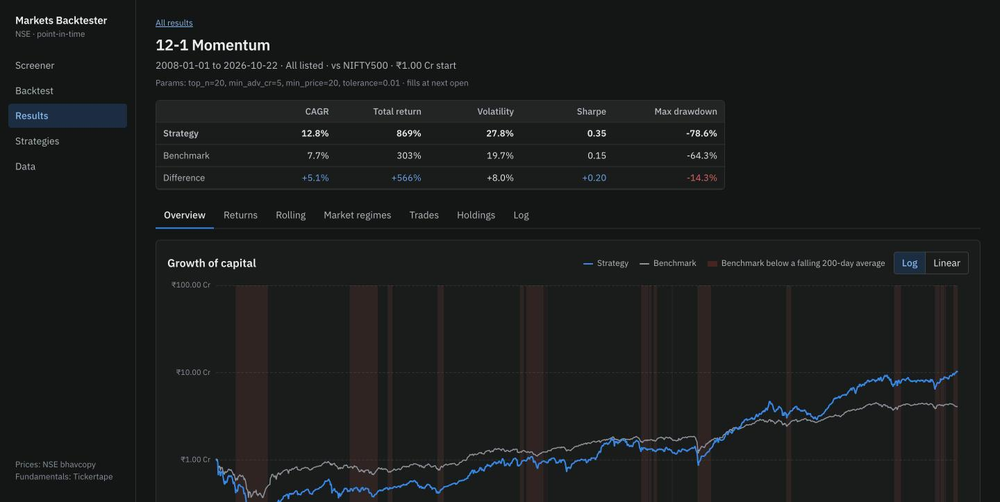

## What it looks like

### Screener

Filter every listed stock with formulas, as of any past date. Each filter is checked as you
type and shows how many stocks pass it today.

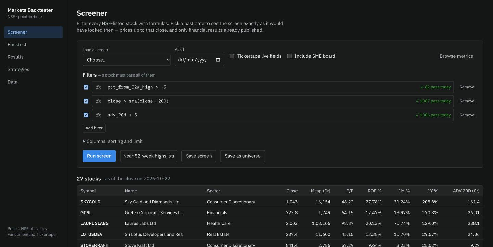

Metric and function names autocomplete, with a description of each.

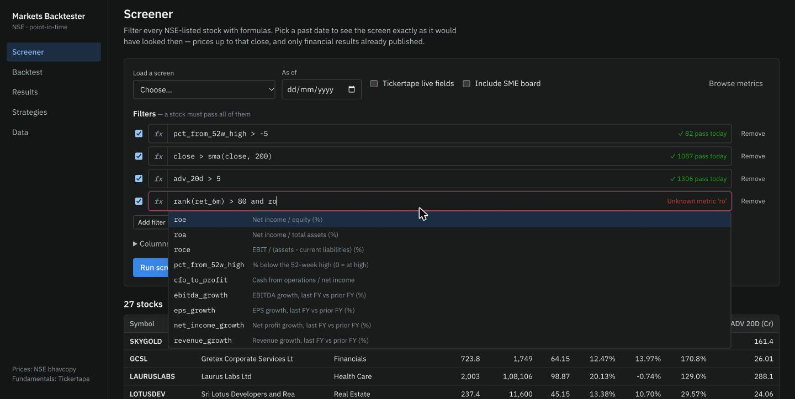

Click a stock for its adjusted price history and latest metrics.

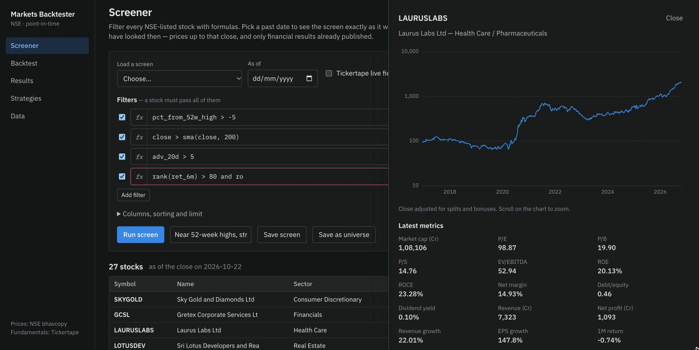

### Backtesting

Pick a strategy and its parameters, a universe (all listed stocks, a saved screen re-run on
every decision date, or hand-picked stocks), a period, capital, benchmark and costs.

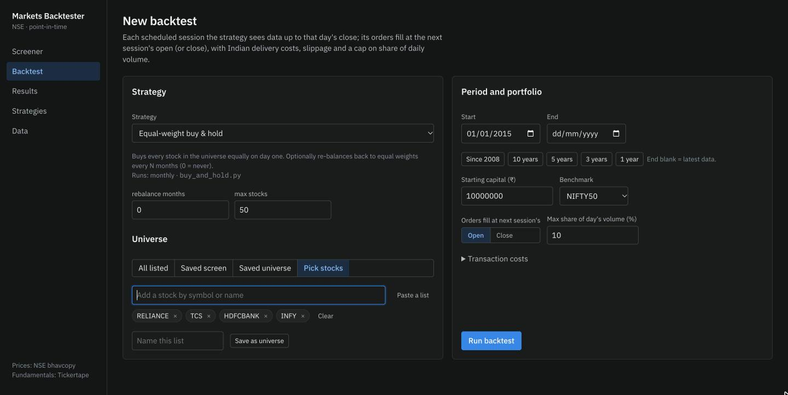

Strategies are Python classes, editable in the app or in your own editor.

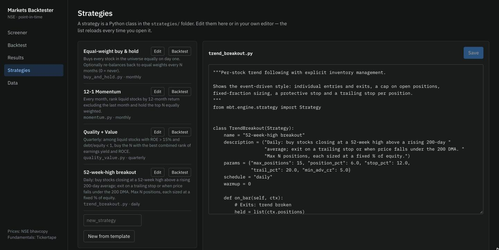

### Results

Drawdowns against the benchmark, exposure and number of holdings:

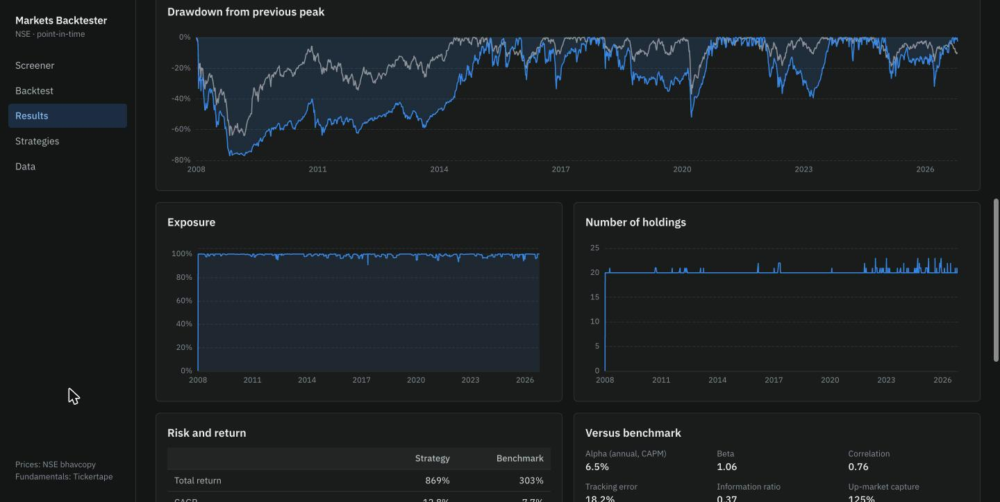

Monthly returns (strategy, benchmark, or the difference):

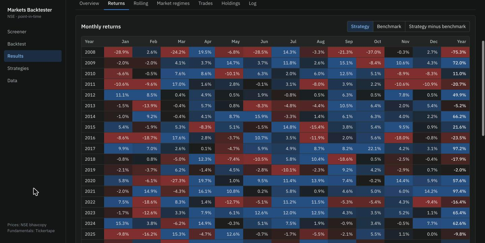

Performance by market regime, each day labelled only with what was known at the time:

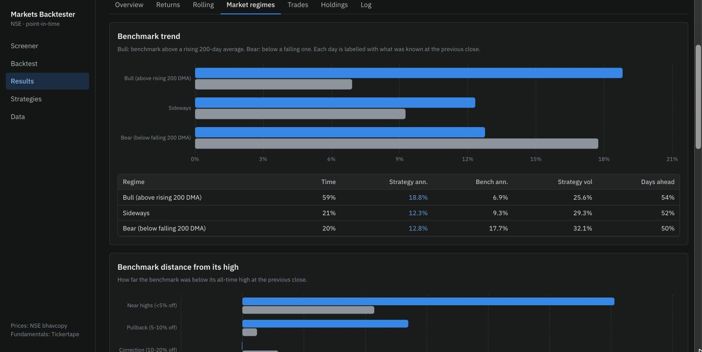

And through notable Indian market episodes:

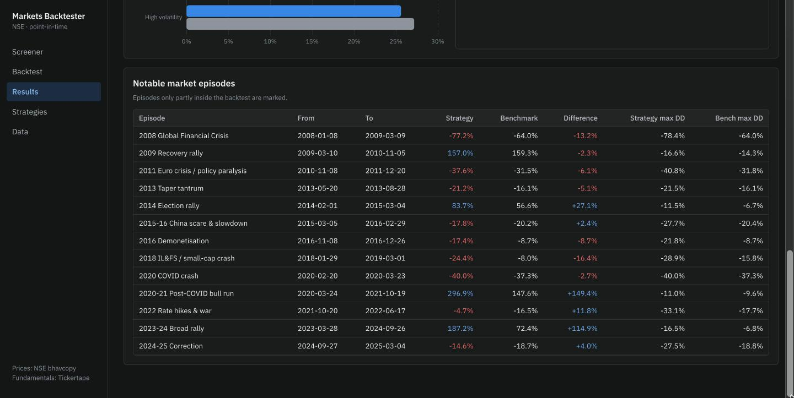

Sector weights over time, biggest contributors and open positions:

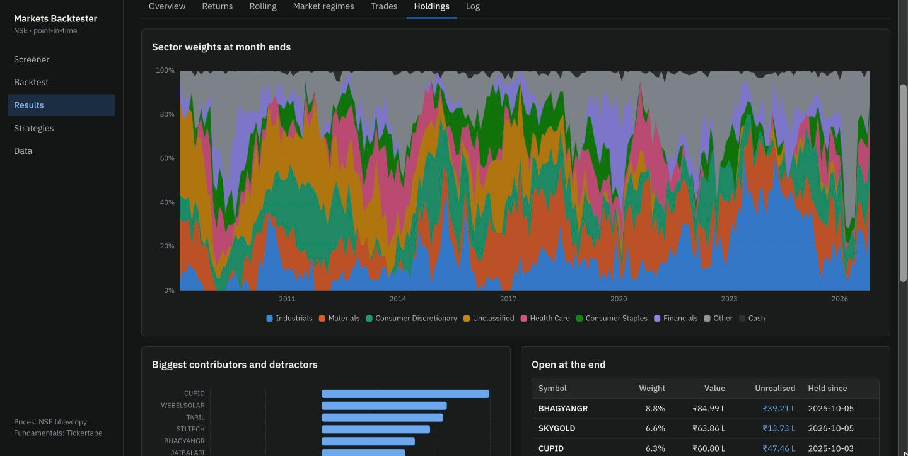

## Run it

```bash
cd backend && uv sync
uv run mbt ingest snapshot corporate_actions  # Tickertape snapshot, then split/bonus history
uv run mbt ingest prices --start 2005-01-01   # NSE bhavcopies; ~1h first time, incremental later
uv run mbt ingest indices fundamentals        # benchmarks; statements (~2h, paced)
uv run mbt serve                              # http://127.0.0.1:8000 (serves frontend/dist)

# frontend development (hot reload, proxies /api to :8000)
cd frontend && npm install && npm run dev
# production build served by the backend
npm run build
```

Tests, including the look-ahead checks: `cd backend && uv run pytest`.

## Data sources

| What | Source | Notes |
|---|---|---|
| Daily OHLCV, all NSE equities incl. delisted | NSE bhavcopy archives | Survivorship-free; Saturday special sessions are skipped |
| Split / bonus / rights adjustment | Tickertape factors, NSE prev-close, gap detection | Merged in `backend/mbt/data/nse.py` |
| Financial statements | Tickertape (`api.tickertape.in`) | Free tier: ~5 FYs + 5 quarters |
| Sectors, live screener fields (`tt_*`) | Tickertape screener | Today's values only |
| Benchmarks | Yahoo Finance | Price indices (no dividends) |

Set `TICKERTAPE_COOKIE` (your logged-in browser's Cookie header) to request premium-only
screener fields.

## Avoiding look-ahead

* The engine calls `on_bar` after a session closes. Orders fill at the **next** session's
  open (or close), with costs, slippage and a cap on the share of daily volume.
* Every data accessor (`ctx.eval`, `ctx.history`, formula functions) is indexed by the
  current session and slices `<= today`.
* Financial statements become visible `period_end + 50 days` (quarters) or `+ 65 days`
  (fiscal years). Change this with `MBT_Q_LAG` / `MBT_A_LAG`.
* Universes are rebuilt every session from the stocks trading that day. A screen used as a
  universe is re-run on every decision date.
* `tests/test_causality.py` runs each strategy on history that ends early and checks that
  every trade matches the full-history run.

## Writing a strategy

Drop a file in `strategies/` (or use the in-app editor):

```python
from mbt.engine.strategy import Strategy

class LowVolQuality(Strategy):
    name = "Low-vol quality"
    params = {"top_n": 30}
    schedule = "monthly"          # daily | weekly | monthly | quarterly | yearly | N sessions

    def on_bar(self, ctx):
        ok = ctx.eval("roe > 15 and adv_63d > 2")
        score = ctx.eval("rank(-vol_1y) + rank(roce)")[ok.astype(bool)]
        picks = score.nlargest(self.p.top_n).index
        ctx.rebalance({s: 1 / len(picks) for s in picks})
```

`ctx` gives you `universe`, `eval(formula)`, `history(field, n)`, `price`, `positions`,
`cash`, `equity`, `buy/sell/order`, `rebalance(weights)`, `set_stop(stop/trail/take-profit)`
and `log`. See `strategies/trend_breakout.py` for a per-position example with stops.

## Known limits

* Fundamentals only go back as far as Tickertape serves (about mid-2022 on the free tier).
  Each refresh keeps old periods, so history builds up over time.
* Statements are as currently reported, so later restatements replace the original numbers.
* Prices aren't adjusted for dividends, and the benchmarks are price indices, so both sides
  exclude dividends.
* Sector classification is current, not historical.

## License

Proprietary. All rights reserved. No use is permitted without written permission; see `LICENSE`.
